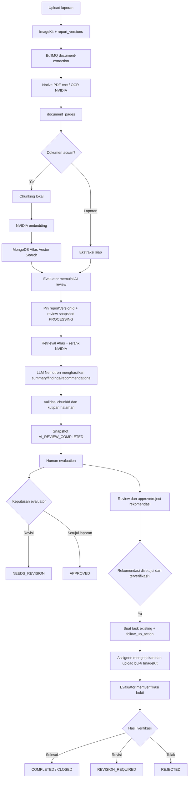

# Workflow OCR, Evaluasi AI, Evaluasi Manusia, dan Tindak Lanjut

## Diagram alur



## 1. Upload, ekstraksi, dan indexing sumber

1. PDF laporan/acuan diunggah ke ImageKit; MongoDB menyimpan metadata file dan versi.
2. Job `document-extraction` mengambil PDF, menggunakan native PDF text, lalu OCR NVIDIA untuk halaman scan.
3. Teks dan status disimpan per halaman di `document_pages`.
4. Untuk dokumen acuan, `TextChunkerService` lokal membagi teks sambil mempertahankan pageStart/pageEnd. NVIDIA membuat embedding; Atlas menyimpan chunk dan vector.
5. Review laporan menanyakan Atlas Vector Search atas dokumen acuan aktif dan dapat melakukan Nemotron reranking. Chunking/retrieval internal eksternal tidak diasumsikan.

## 2. AI review snapshot

1. Evaluator membuat review untuk versi laporan yang sudah selesai diekstrak.
2. Backend membuat `report_reviews` status `PROCESSING` dan job membawa `reportVersionId` serta `reviewId` tetap. Evaluasi ulang membuat review baru.
3. Worker mengambil teks versi tersebut, template version jika ada, sumber retrieval yang terambil, dan halaman teks laporan untuk validasi bukti.
4. Nemotron menghasilkan ringkasan, status compliance, temuan, keterbatasan, rekomendasi perbaikan laporan, dan rekomendasi perbaikan inspeksi.
5. Source chunk dan pasangan dokumen/versi yang bukan hasil retrieval dibuang. Assessment per dokumen disimpan hanya jika ada passage retrieval untuk dokumen/versi tersebut. Kutipan halaman hanya dipersist jika string kutipan ada pada teks halaman yang bersangkutan. Data yang tidak tervalidasi ditandai `NOT_ASSESSABLE`/`NEEDS_VERIFICATION`.
6. Snapshot menyimpan versi laporan, model, timestamp, status pemrosesan, sources, finding, recommendation, limitations, dan status verifikasi manusia.
7. Kegagalan terminal menandai snapshot `FAILED`. Retry membuat snapshot/job baru dan menyimpan relasi `retryOf`.

Confidence model bersifat opsional dan bukan probabilitas keputusan. Skor AI tidak menjadi persetujuan atau keputusan hukum.

## 3. Evidence & regulation mapping

Finding menghubungkan `reportEvidence` (halaman laporan/kutipan tervalidasi) dan `sourceChunkIds`. `review_sources` menyimpan passage dan metadata aktual Atlas: `documentId`, `documentVersionId`, rentang halaman regulasi, bagian, chunkId, serta teks. API mapping mengembalikan relasi source ke findings.

Nomor pasal, nama/nomor dokumen acuan, dan halaman tidak diisi hasil tebakan. Jika metadata tidak diberikan dokumen atau passage, pengguna menandai kebutuhan verifikasi manual. Evidence laporan dan source regulasi dibedakan.

## 4. Human evaluation

1. Pimpinan/admin memilih snapshot AI completed dan membuat `human_evaluation` dengan versi laporan/review yang sama.
2. Evaluator menambah catatan dan keputusan compliance per finding.
3. Evaluator dapat mengubah status compliance dan meninjau mapping serta rekomendasi.
4. Approval manusia mengubah status laporan ke `APPROVED`; permintaan revisi mengubahnya ke `NEEDS_REVISION`.
5. Setiap tindakan evaluasi/follow-up dicatat pada `evaluation_history`. Keputusan tidak mengubah atau menimpa snapshot AI.

## 5. Rekomendasi dan follow-up task

Rekomendasi `REPORT_IMPROVEMENT` dan `INSPECTION_IMPROVEMENT` disimpan terpisah dalam `ai_recommendations`. Evaluator dapat memperbaiki catatan/aksi, menandai status verifikasi, approve atau reject. Rekomendasi yang membutuhkan verifikasi tidak dapat langsung menjadi tugas.

Pimpinan/admin membuat follow-up hanya dari rekomendasi yang sudah `APPROVED` dan `SUPPORTED`. Backend membuat satu record `follow_up_actions` yang terhubung ke satu task di koleksi `tasks`; unique index `recommendationId` membuat pemanggilan ulang idempotent. Task tetap memakai modul existing.

Assignee dapat memulai pekerjaan, kemudian mengunggah bukti PDF/JPG/PNG. Biner disimpan di ImageKit, metadata di `follow_up_evidence`. Verifier dapat menyelesaikan, meminta revisi, atau menolak. Bukti lama dan riwayat keputusan tidak dihapus ketika ada revisi. Pimpinan/admin menutup laporan setelah semua follow-up selesai.

Status tindak lanjut: `OPEN → ASSIGNED → IN_PROGRESS → SUBMITTED → UNDER_VERIFICATION → COMPLETED | REVISION_REQUIRED | REJECTED`. Revisi dapat dikirim kembali sebagai submission baru. Perubahan status ditulis sebagai event history.

## 6. Workflow manusia tetap pemilik keputusan

```text
UPLOAD_REPORT
→ OCR_PROCESSING
→ TEXT_EXTRACTION
→ AI_REVIEW_PROCESSING
→ AI_REVIEW_COMPLETED
→ HUMAN_REVIEW
→ APPROVED atau REVISION_REQUIRED
→ FOLLOW_UP
→ FOLLOW_UP_VERIFICATION
→ CLOSED
```

`AI_REVIEW_COMPLETED` hanya berarti analisis AI selesai. Pimpinan/evaluator memegang keputusan akhir laporan, status kepatuhan terverifikasi, serta penutupan tindak lanjut.

## 7. Pengujian yang harus dijalankan

- Unit test: validasi sumber chunk, evidence halaman, pemetaan recommendation type/status, status transition dan actor authorization.
- Mock NVIDIA, embedding, reranking, ImageKit, BullMQ; pengujian tidak boleh membutuhkan API key eksternal.
- Integration test MongoDB: review snapshot, retry membuat snapshot baru, unique follow-up idempotency, evidence metadata, dan history.
- RBAC: anggota tidak dapat melihat laporan/follow-up pengguna lain, memutuskan evaluasi, atau memverifikasi; assignee tidak dapat mengelola task orang lain.
- Regression: route existing report review/approval, task, indexing, retrieval, dan ekstraksi tetap terdaftar.
