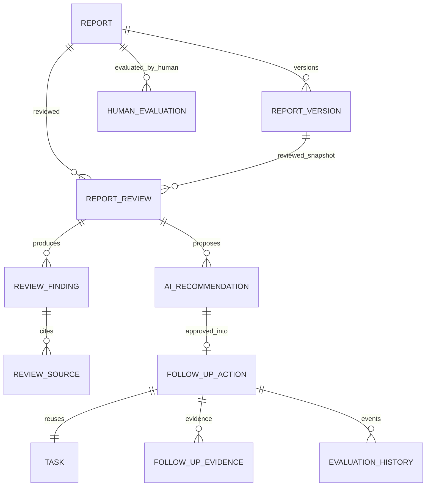

# Skema MongoDB SPI v2

Database MongoDB Atlas adalah penyimpanan data aplikasi dan vector search yang sudah berjalan. PDF dan lampiran berada di ImageKit; database menyimpan metadata dan URL/provider IDs. Collection tambahan di bawah bersifat non-destruktif; koleksi lama tidak dihapus.

## Koleksi yang digunakan pada alur evaluasi

| Collection | Identitas/relasi | Data penting | Index |
|---|---|---|---|
| `reports` | `_id`; `createdBy` user | `data` laporan, status workflow, `version`, `latestReviewId`, `humanEvaluationId` | status dan createdAt (existing generic schema; index spesifik lanjutan disarankan) |
| `report_versions` | `reportId` → report | nomor versi, status ekstraksi, metadata ImageKit, `data.templateVersionId`, halaman teks direferensikan lewat versionId | `{reportId, version, createdAt}` disarankan |
| `report_reviews` | `reportId`, `reportVersionId`, `templateVersionId` | status job AI, reviewer/requestor, jobId, model, embedding/rerank model, waktu, summary, limitations, source count dan status verifikasi | `{reportId, createdAt}`, unique `jobId` disarankan |
| `review_findings` | `reviewId` → review; `reportId` | title, description, priority, complianceStatus AI, reasoning, confidence, `reportEvidence[]`, `sourceChunkIds[]`, `humanReview` | `{reviewId, createdAt}`, `{reportId, reviewId}` disarankan |
| `review_sources` | `reviewId`, `findingId`, `documentId`, `documentVersionId`, `chunkId` | page range, section, passage text hasil retrieval | `{reviewId, chunkId}`, `{documentVersionId, chunkId}` disarankan |
| `ai_recommendations` | `reportId`, `reportVersionId`, `reviewId`, opsional `findingId` | type, title, description, rationale, action, priority, status, verification status, bukti laporan, regulatory source snapshot, actor review | `{reviewId,type,createdAt}`, `{reportId,status}`, unique `recommendationId` ada di follow-up |
| `human_evaluations` | `reportId`, `reportVersionId`, `reviewId`, `reviewerId` | status, note, keputusan per finding, waktu keputusan | `{reportId,createdAt}`, `{reviewId}` |
| `follow_up_actions` | `reportId`, versi, review/evaluation, `recommendationId`, `taskId`, `assigneeId` | status, due date, verifier dan timestamp | unique `recommendationId`, unique `taskId`, `{reportId,createdAt}`, `{assigneeId,status}` |
| `tasks` | `_id` = `taskId` follow-up | task tetap memakai model existing; `data.followUp` menyimpan linkage report/version/review/recommendation | tambahkan `{data.assigneeId,status}` sesuai query task |
| `follow_up_evidence` | `followUpId`, `taskId`, `uploadedBy` | ImageKit metadata, description, status verifikasi, actor dan catatan | `{followUpId,createdAt}` |
| `evaluation_history` | report dan salah satu followUp/task/evaluation | actor, action, from/to status, note, metadata | `{reportId,createdAt}`, `{followUpId,createdAt}` |
| `document_pages` | `documentVersionId`, pageNumber | extracted/OCR text dan extraction status | unique `{documentVersionId,pageNumber}` disarankan |
| `document_chunk_vectors` | document/version/chunk | text, embedding model/vector, page range, section, ACTIVE/DRAFT/ARCHIVED | unique `{documentVersionId,chunkId}` existing; Atlas Vector Search index `spi_chunks_vector_idx` |
| `notifications` | `recipientUserId` → user, `resource` → domain object | category, priority, title/message, allowlisted deep link, `readAt`, `eventId` | `{recipientUserId,createdAt,_id}`, `{recipientUserId,readAt,createdAt}`, unique `{eventId,recipientUserId}` |
| `notification_preferences` | unique `userId` → user | timezone dan email preference per kategori; tidak menyimpan SMTP credentials | unique `{userId}` |
| `notification_logs` | `recipientUserId`, optional `notificationId` | channel, delivery status, attempt count/time, sentAt, sanitized errorCode, idempotency key | unique `idempotencyKey`, `{recipientUserId,createdAt}`, `{status,createdAt}` |

Report, report-version, task, dan document-page collections existing masih memakai `DomainSchema` generik dengan `data: Mixed`. Review, finding, source, approval, recommendation, human evaluation, follow-up, evidence, dan history memakai schema Mongoose spesifik pada `src/reports/evaluation.schemas.ts`. Perubahan schema tidak menghapus atau menulis ulang dokumen yang sudah ada.

## Field bukti dan regulasi

`reportEvidence[]` berisi `{pageNumber, quote}` hanya jika quote tervalidasi sebagai substring teks halaman hasil ekstraksi. `regulationSources[]` pada recommendation adalah snapshot metadata source retrieval yang nyata: `chunkId`, `documentId`, `documentVersionId`, pageStart/pageEnd, section, dan text. Karena koleksi `reference_documents` belum memiliki kontrak field judul/nomor yang kuat pada hasil retrieval, nama/nomor peraturan tidak ditebak; hubungan dapat di-resolve ke dokumen dan versi acuan.

## Relasi

## Konsistensi, keamanan, retensi

- Evaluasi AI menyimpan `reportVersionId` yang dipilih saat job dibuat; review ulang membuat snapshot baru.
- ObjectId references divalidasi sebelum pembuatan hubungan; unique key mencegah tindak lanjut duplikat untuk satu rekomendasi.
- Upload ImageKit dan metadata MongoDB tidak membentuk transaksi tunggal. Implementasi melakukan cleanup jika pencatatan evidence gagal; reconciliation umum tetap perlu disiapkan.
- Jangan menyimpan PDF/base64 di MongoDB. URL/fileId tetap memerlukan kontrol akses private/signed yang terpisah.
- Jangan memasukkan teks klinis atau kredensial ke log audit. Tetapkan retensi berdasarkan kebijakan organisasi.
- Pembuatan index baru di Atlas harus dilakukan setelah audit data existing; hindari index unique pada data lama sebelum duplikasi diperiksa.

Field dan index notifikasi di atas adalah kontrak target dan belum dibuat oleh implementasi sekarang. Lihat [`contracts/NOTIFICATIONS-API-CONTRACT.md`](contracts/NOTIFICATIONS-API-CONTRACT.md) untuk endpoint, event, dan RBAC lengkap.
